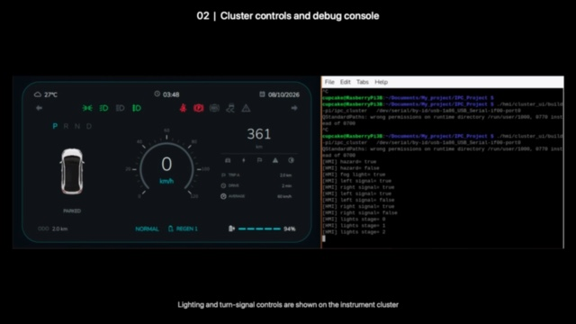

# EV Instrument Cluster

An embedded electric-vehicle instrument cluster prototype built with Qt/QML,
C/C++, Raspberry Pi 3B+, Arduino Uno and ESP32.



[Hardware demo](https://github.com/Cupcake137/EV-Instrument-Cluster/releases/tag/v1.0.0)

## Overview

The Uno reads throttle and gear inputs and drives a DC motor through an L298.
The Pi runs the VCU logic and instrument cluster. An ESP32 keypad sends MQTT
events for menu navigation and display controls.

```text
ESP32 keypad -- MQTT --> Pi VCU + Qt/QML cluster
Arduino Uno <-- UART --> Pi VCU
Arduino Uno -- PWM --> L298 --> DC motor
```

## Features

- P/R/N/D gear handling, ECO/NORMAL/SPORT modes and limited Reverse output.
- ECU command timeout, fresh-telemetry watchdog and safe latched-fault clearing.
- Shared DBC definitions, payload CRC and alive counters over UART/MQTT.
- Animated speed gauge, telltales, five menu pages and persistent ODO/Trip.
- Regression tests for control logic, UART safety, menus and distance tracking.

## Source Layout

| Directory | Responsibility |
|---|---|
| `firmware/arduino_motor_ecu` | Inputs, motor output and ECU watchdog |
| `firmware/esp32_keypad_controller` | Keypad scanning and MQTT events |
| `vcu/c_core` | C reference logic and frame simulation |
| `vcu/cpp_backend` | VCU state machine, diagnostics and communication |
| `hmi/cluster_ui` | Qt/QML display and backend integration |
| `can_database` | Shared message and signal definitions |

## Build And Preview

Requires Qt 5.15 (Core, Gui, Qml, Quick, SerialPort, Test), CMake, Ninja,
a C/C++ compiler and libmosquitto. Firmware uses PlatformIO.

```bash
make -C vcu/c_core clean test
cmake -S vcu/cpp_backend -B vcu/cpp_backend/build -G Ninja -DBUILD_TESTING=ON
cmake --build vcu/cpp_backend/build
ctest --test-dir vcu/cpp_backend/build --output-on-failure
cmake -S hmi/cluster_ui -B hmi/cluster_ui/build -G Ninja -DBUILD_TESTING=ON
cmake --build hmi/cluster_ui/build
ctest --test-dir hmi/cluster_ui/build --output-on-failure
./hmi/cluster_ui/build/ipc_cluster --simulate --no-mqtt
```

On Apple Silicon with Homebrew Qt 5, add
`-DCMAKE_PREFIX_PATH=/opt/homebrew/opt/qt@5` to the CMake configure commands.

Build firmware with `pio run --project-dir firmware/arduino_motor_ecu` or
`pio run --project-dir firmware/esp32_keypad_controller`. For ESP32, create a
local `include/secrets.h` from `include/secrets.example.h` first. Credentials
must not be committed.

## Hardware Interface

Uno: A0 throttle, D9/D10 gear buttons, D7/D8 direction and D5 PWM.
The Pi UART link uses Uno SoftwareSerial D2 RX/D3 TX at 9600 baud; Uno USB
debug uses 115200 baud. Use suitable logic-level conversion and a common
signal ground. Power the motor separately from the Uno 5 V output.

The cluster embeds the backend. Never run it alongside a second backend on
the same serial device. Hardware mode takes the serial path as an argument
and MQTT settings through `IPC_MQTT_HOST`, `IPC_MQTT_PORT`, `IPC_MQTT_USER`
and `IPC_MQTT_PASSWORD`.

## Scope

This is an educational prototype, not a road-certified controller. UART and
MQTT transport CAN-shaped frames, not physical CAN. Speed is PWM-derived and
SOC is simulated in Uno RAM. Temperature, lighting and regen include display
demonstrations; there is no BMS, physical BCM or regenerative power stage.
Measured speed/SOC and further electrical-noise validation are future work.

## Credits

The HMI uses [cppqtdev/Qt-HMI-Display-UI](https://github.com/cppqtdev/Qt-HMI-Display-UI)
as a source/design reference. See [Third-Party Notices](THIRD_PARTY_NOTICES.md)
and [Rights And Licensing](LICENSE.md) for retained code and artwork attribution.
